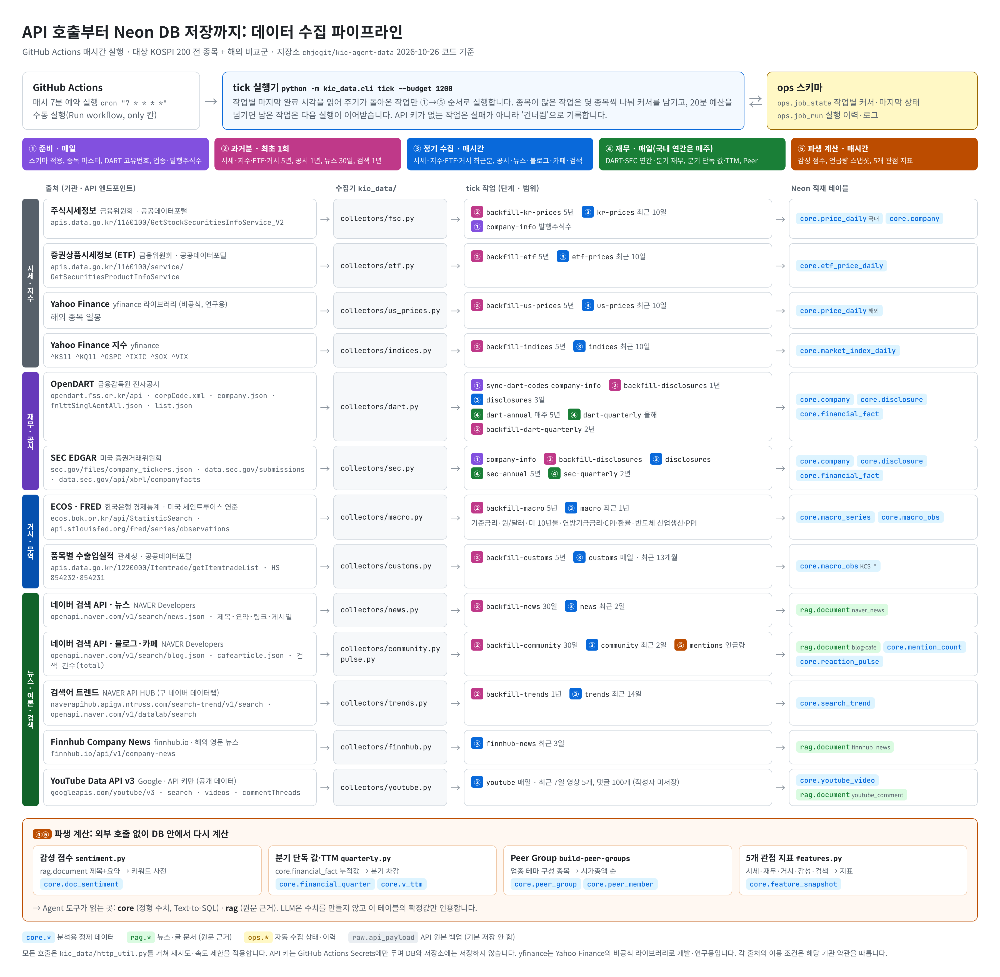
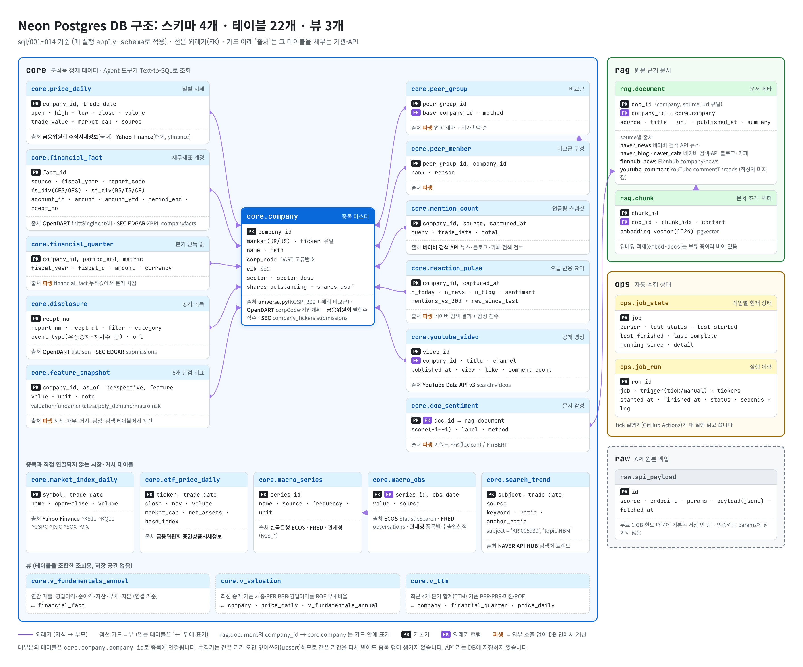

# KIC AI Agent 데이터 수집 환경

Neon(Postgres + pgvector)에 국내·해외 주식 데이터를 모으는 VS Code용 Python 프로젝트입니다.
5개 관점(밸류에이션·펀더멘털·수급·거시·리스크) 에이전트와 오케스트레이터가 읽을 `features.json` 까지 만듭니다.
수집 현황과 앞으로 필요한 데이터는 [`docs/DATA_STATUS.md`](docs/DATA_STATUS.md) 에 정리했습니다.

> **자동 수집 (10-26):** GitHub 비공개 저장소에 올리면 GitHub Actions 가 2시간마다 수집합니다 (서버·PC 불필요).
> 설정 방법: [`docs/AUTO_RUN.md`](docs/AUTO_RUN.md). 웹 대시보드를 서버에 올리려면 [`docs/DEPLOY_VERCEL.md`](docs/DEPLOY_VERCEL.md) (선택).
> 작업 스케줄러(`scripts/*.bat`)와는 둘 중 하나만 쓰세요.

## 한눈에 보는 구조 (그림)

### API 호출부터 Neon DB 저장까지



GitHub Actions 가 매시간 `tick` 을 실행하면, 주기가 돌아온 작업만 ① 준비 → ② 과거분 → ③ 정기 수집 → ④ 재무 → ⑤ 파생 계산 순서로
외부 API 를 호출해 Neon 에 적재합니다. 작업 상태는 `ops` 스키마에 남고, 20분 예산을 넘긴 작업은 다음 실행이 이어받습니다.

### DB 구조



### 데이터 출처

| 데이터 | 제공 기관 · API | 적재 테이블 |
|---|---|---|
| 국내 주식 일별 시세, 발행주식수 | 금융위원회 주식시세정보 (공공데이터포털 `GetStockSecuritiesInfoService_V2`) | `core.price_daily`, `core.company` |
| 국내 ETF 시세·NAV | 금융위원회 증권상품시세정보 (공공데이터포털 `GetSecuritiesProductInfoService`) | `core.etf_price_daily` |
| 해외 주식 시세, 시장 지수 | Yahoo Finance (`yfinance`, 비공식 라이브러리 · 개발·연구용) | `core.price_daily`, `core.market_index_daily` |
| 국내 재무제표·공시·기업개황 | 금융감독원 OpenDART (`corpCode`, `company`, `fnlttSinglAcntAll`, `list`) | `core.financial_fact`, `core.disclosure`, `core.company` |
| 해외 재무제표·제출서류 | 미국 SEC EDGAR (`company_tickers`, `submissions`, XBRL `companyfacts`) | `core.financial_fact`, `core.disclosure`, `core.company` |
| 국내 거시 (기준금리·원/달러) | 한국은행 ECOS (`StatisticSearch`) | `core.macro_series`, `core.macro_obs` |
| 미국 거시·환율·반도체 업황 | 세인트루이스 연준 FRED (`series/observations`) | `core.macro_series`, `core.macro_obs` |
| 반도체 수출입 (HS 854232·854231) | 관세청 품목별 수출입실적 (공공데이터포털 `Itemtrade`) | `core.macro_obs` (`KCS_*`) |
| 국내 뉴스 (제목·요약·링크) | 네이버 검색 API `news` | `rag.document` (`naver_news`) |
| 블로그·카페 반응, 언급량 | 네이버 검색 API `blog`·`cafearticle` (검색 건수 포함) | `rag.document`, `core.mention_count`, `core.reaction_pulse` |
| 검색 관심도 | NAVER API HUB 검색어 트렌드 (구 네이버 데이터랩) | `core.search_trend` |
| 해외 영문 뉴스 | Finnhub `company-news` | `rag.document` (`finnhub_news`) |
| 유튜브 공개 영상·댓글 | YouTube Data API v3 (`search`, `videos`, `commentThreads`, API 키만) | `core.youtube_video`, `rag.document` (`youtube_comment`) |

감성 점수(`core.doc_sentiment`), 분기 단독 값·TTM(`core.financial_quarter`, `core.v_ttm`), Peer Group, 5개 관점 지표(`core.feature_snapshot`)는
위 테이블에서 DB 안에서 계산한 파생 값입니다. 각 출처의 이용 조건은 제공 기관 약관을 따릅니다.
그림 원본은 `docs/diagrams/*.html` 이고, 고친 뒤 `node docs/diagrams/render.js` 로 PNG 를 다시 만듭니다.

## 0. 팀 결정 사항 (코드에 반영됨)

| 항목 | 결정 |
|---|---|
| DB | Neon(온라인 Postgres). DB 접근은 `kic_data/db.py` 한 곳 |
| 시범 업종 | 반도체 Peer Group (+ NAVER·Apple·Microsoft 보조 비교군) |
| 시장 | 국내·해외 주식 동시 진행, ETF 는 나중에 |
| 국내 시세 | 금융위원회 주식시세정보(FSC, 공공데이터포털) |
| 해외 시세·지수 | yfinance (비공식, 개발·연구용) |
| 제외 | 토스증권 Open API, 한국투자증권 KIS, 로그인 필요한 소스(KRX 로그인 기반 pykrx 등) |
| 관세청 수출입 | 반도체 HS 854232·854231 월별 수출입 금액 (`collect-customs`, 2026-10-26 활용신청 승인 후 자동 수집에 추가) |
| 보류 | 국내 투자자별 수급·공매도, RAG 임베딩 적재(`embed-docs`) |
| 뉴스 | 네이버 검색 API — 제목·요약·링크·게시일만 (본문 미수집) |
| 유튜브 | YouTube Data API 공개 데이터만 (API 키, OAuth 사용자 데이터 없음) — 영상 제목·통계, 공개 댓글 본문·작성일 (작성자 미저장) |
| 자동화 | 매일 자동 갱신(`daily-update`) + 종목별 검색 관심도 |

## 1. 준비 (최초 1회)

```bash
python -m venv .venv
# Windows: .venv\Scripts\activate   /  Mac·Linux: source .venv/bin/activate
pip install -r requirements-dev.txt   # 테스트·로컬 웹 포함 (배포용은 requirements.txt)
copy .env.example .env      # Mac·Linux: cp .env.example .env
```

`.env` 를 열어 값을 채웁니다. **DATABASE_URL 은 Neon의 direct 연결 문자열(호스트에 `-pooler` 없음)**.
`.env` 는 `.gitignore` 에 있어 커밋되지 않으며, 채팅·문서에 붙여넣지 마세요.
예전 `.env` 에 남아 있는 `TOSS_CLIENT_ID`, `TOSS_CLIENT_SECRET` 은 더 이상 쓰지 않으니 지워도 됩니다.

## 2. 처음 한 번 전체 수집 (순서대로)

```bash
python -m kic_data.cli check-db                 # 연결 확인
python -m kic_data.cli apply-schema             # sql/001~013 적용 (여러 번 실행해도 안전)
python -m kic_data.cli check-sources            # 키가 있는 API 를 1회씩 호출해 확인
python -m kic_data.cli seed-companies           # kic_data/universe.py 종목 등록
python -m kic_data.cli sync-dart-codes          # KR 종목에 DART 고유번호 연결
python -m kic_data.cli collect-company-info     # 업종코드·발행주식수 (시가총액·PER 계산에 필요)

python -m kic_data.cli collect-kr-prices --days 1825      # 5년치 (FSC 330일씩 나눠 호출)
python -m kic_data.cli collect-us-prices --days 1825
python -m kic_data.cli collect-indices   --days 1825      # 코스피·코스닥·S&P500·나스닥·SOX·VIX
python -m kic_data.cli collect-dart      --from-year 2021 # 연간 재무
python -m kic_data.cli collect-dart-q    --from-year 2021 # 분기 재무
python -m kic_data.cli collect-sec       --from-year 2021
python -m kic_data.cli collect-sec-q     --from-year 2021
python -m kic_data.cli collect-macro     --years 5        # ECOS·FRED (EUR·TWD 환율 포함)
python -m kic_data.cli collect-disclosures --days 365     # DART(A·B·I)·SEC 제출서류 목록
python -m kic_data.cli collect-news      --days 30        # 네이버 뉴스 → rag.document
python -m kic_data.cli collect-community --days 30        # 네이버 블로그·카페 (개인 투자자 반응)
python -m kic_data.cli collect-trends    --days 365       # 검색 관심도 (NAVER API HUB)
python -m kic_data.cli score-sentiment                    # 제목+요약 감성 점수

python -m kic_data.cli build-quarterly          # 분기 단독 값 → TTM
python -m kic_data.cli build-peer-groups        # 비교군
python -m kic_data.cli build-features           # 5개 관점 지표
python -m kic_data.cli export-features          # features.json
python -m kic_data.cli status                   # 수집 현황 점검 (아래 4절)
```

키가 아직 없는 소스는 건너뛰고 나중에 추가하면 됩니다. 종목은 `kic_data/universe.py` 에서 바꿉니다.

## 3. 매일 자동 갱신 (Windows 작업 스케줄러)

`daily-update` 는 시세·지수·뉴스·공시·거시·검색 관심도·블로그/카페·감성·언급량 스냅샷을 최근분만 수집한 뒤
`build-features`, `export-features` 까지 실행합니다. 결과 코드 0 = 전부 성공, 1 = 일부 실패(로그의 `실패한 단계:` 줄 확인).
**팀원 중 한 명의 PC에만 등록하세요** (DB 공유). PC가 켜져 있어야 실행되며 로그는 `logs/` 에 쌓입니다.

```bat
schtasks /Create /SC DAILY /ST 18:30 /TN "kic_daily_update" /TR "\"%CD%\scripts\daily_update.bat\""
schtasks /Run /TN "kic_daily_update"      &REM 등록 직후 한 번 바로 실행해 보기
schtasks /Query /TN "kic_daily_update" /V /FO LIST | findstr /C:"Last Run" /C:"Last Result"
```

장중 여론 펄스(선택, 정규장 15분 간격. 정규장 밖이면 스스로 건너뜀):
```bat
schtasks /Create /SC WEEKLY /D MON,TUE,WED,THU,FRI /ST 09:00 /RI 15 /DU 0006:45 /TN "kic_pulse" /TR "\"%CD%\scripts\pulse.bat\""
```

## 4. 수집 현황 점검

```bash
python -m kic_data.cli status                      # 종목별 시세·재무·공시·뉴스·감성·검색·언급량·지표 채움 수 + 최신성
python -m kic_data.cli status --json status.json   # 같은 내용을 파일로 (팀 공유용)
```
읽기 전용(SELECT 만)입니다. `오래됨` 이 보이면 해당 수집 명령이나 스케줄러 로그를 확인하세요.

## 5. 테스트 (DB·네트워크 불필요)

```bash
python -m unittest discover -s tests -t .
```

## 6. 웹 백엔드에서 쓰는 진입점

```python
import json
features = json.load(open("features.json", encoding="utf-8"))   # {"KR:005930": {valuation:{...}, fundamentals:{...}, ...}}

from kic_data.pulse import refresh_ticker
data = refresh_ticker("KR", "005930")   # 종목 클릭 시 오늘 여론 즉시 갱신 (5분 캐시)
```

## 7. 데이터별 메모

### 검색 관심도 (네이버 데이터랩 → NAVER API HUB)
- 2026-07-31 부터 데이터랩 신규 신청은 **NAVER API HUB** 로 이전. `.env` 에 `NCP_APIHUB_KEY_ID`, `NCP_APIHUB_KEY` 가 있으면 HUB 를 씁니다 (월 5만 건 한시 무료).
- 종목별 '○○ 주가'·'○○ 주식' 검색량을 '주식' 검색량 대비 상대값으로 저장 → 요청이 달라도 비교 가능 (`ratio / anchor_ratio`).
- 지표: `search_attention_7d_vs_90d`(관심 급증 배수), `search_attention_level_7d`(종목 간 비교). 전일까지 일 단위 (실시간 아님).

### 개인 투자자 반응 (블로그·카페) + 감성 점수
- 네이버 공식 검색 API(블로그·카페글)만 씁니다. 종목토론실 내부 API 는 공개 API 가 아니라 쓰지 않습니다.
- 지표: `sentiment_1d`, `sentiment_1d_vs_7d`, `mentions_1d_vs_30d`, `crowd_sentiment_7d`, `crowd_sentiment_chg`, `news_sentiment_7d`, `crowd_posts_7d_vs_30d`.
- 7일 톤은 최근일 가중(오늘×3, 어제×2, `features.RECENCY_WEIGHTS`). 당일 지표는 작성일이 확실한 뉴스·블로그만.
- 감성은 기본 키워드 사전 방식(`kic_data/sentiment.py`). 사전을 고친 뒤엔 `score-sentiment --rescore`.
  모델: `pip install -r requirements-sentiment.txt` 후 `score-sentiment --method finbert` (CPU 로는 느림).
- 카페글은 API 가 작성일을 주지 않아 '처음 수집한 날' 기준입니다.

### 언급량
- 검색 결과 누적 수(total)의 하루 증가분으로 계산합니다 (`core.mention_count`). 하루 1회 이상 스냅샷이 쌓여야 값이 나옵니다 (6~14일).
- 호출량: 17종목 × 3회 × 26회 ≈ 하루 1,330회 (네이버 검색 API 일 25,000회 한도).

### 해외 20-F 기업 (ASML·TSMC)
- 재무가 EUR·TWD 라 연간 PER/PBR 을 FRED 환율(`DEXUSEU`, `DEXTAUS`, `collect-macro` 로 수집)로 USD 환산해 채웁니다 (지표 note 에 환율·기준일 표기).
- 분기 보고서(10-Q)가 없고 6-K 로 제출해서 TTM·분기 성장률은 비어 있는 것이 정상입니다.

### 그 밖에
- `yfinance` 는 비공식 라이브러리입니다. 개발·연구용이며 기획서 부록에 출처·이용조건을 적으세요.
- 국내 투자자별 수급·공매도는 계정 로그인이 필요한 소스뿐이라 수집하지 않습니다 (`investor_flows` = 미수집 표시).
- 공시 분류(`event_type`)는 보고서명 키워드 규칙입니다 (`collectors/dart.py` 의 `EVENT_KEYWORDS`).
- FCF 계산용 현금흐름표 계정 확인:
  `SELECT DISTINCT account_id, account_nm FROM core.financial_fact WHERE sj_div = 'CF' AND source = 'dart' ORDER BY 1;`
- 아직 실제 응답으로 검증하지 못한 부분: 관세청 API(보류). ECOS 기준금리·환율 코드는 2026-10-21 수집 결과로 확인됨.
- Neon 무료 한도: 1 GB, 5분 무활동 시 절전(첫 접속이 느림). `raw` 스키마 저장은 기본 꺼짐.
